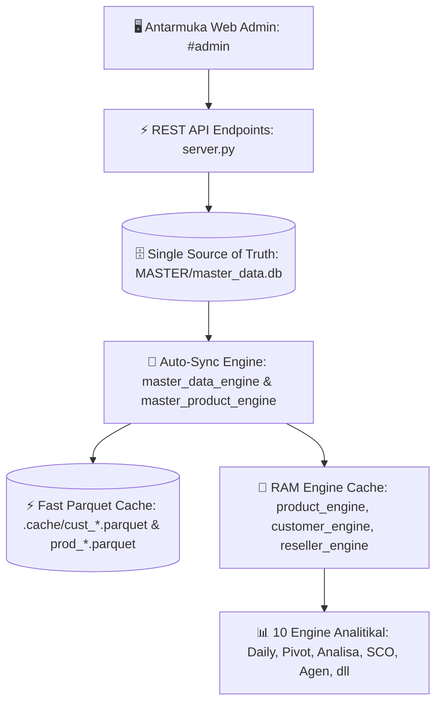

# 🛡️ PANDUAN TEKNIS & DOKUMENTASI RESMI: ADMIN DATA & MASTER HUB

Dokumen ini adalah spesifikasi arsitektur, panduan teknis, dan standar operasional resmi untuk modul **Admin Data & Master Hub (`#admin`)** pada sistem **WEB REPORT BI** per **08 Oktober 2026**.

---

## 📌 DAFTAR ISI
1. [Filosofi & Arsitektur Web-First](#1-filosofi--arsitektur-web-first)
2. [Sub-Tab 1: Ingestion & Radar TSV OtomaX](#2-sub-tab-1-ingestion--radar-tsv-otomax)
3. [Sub-Tab 2: Master Agen & Reseller MLM](#3-sub-tab-2-master-agen--reseller-mlm)
4. [Sub-Tab 3: Master Produk & Kategori](#4-sub-tab-3-master-produk--kategori)
5. [Arsitektur Caching Berjenjang (Hierarchical Cache)](#5-arsitektur-caching-berjenjang)
6. [Katalog API Endpoints (`server.py`)](#6-katalog-api-endpoints)
7. [Matriks Integrasi 10 Engine Analitikal](#7-matriks-integrasi-10-engine-analitikal)
8. [Panduan Operasional & Troubleshooting](#8-panduan-operasional--troubleshooting)

---

## 1. FILOSOFI & ARSITEKTUR WEB-FIRST

Sebelumnya, pembaruan master data customer dan produk bergantung pada pengeditan manual file Microsoft Excel (`CUSTOMER_ASTAGA.xlsx`, `CUSTOMER_OKI.xlsx`, `PRODUCT_ASTAGA.xlsx`, `PRODUCT_OKI.xlsx`). Pendekatan ini memiliki kelemahan:
- **Resiko Human Error**: Kolom tergeser, spasi tak terlihat (`\xa0`), format teks korup.
- **Konflik Kode Produk Antar-Brand**: 395 kode produk identik antara ASTAGA dan OKIPAY berisiko tertimpa jika disatukan sembarangan.
- **Lambat**: Membaca file Excel berukuran besar memakan waktu $3 - 8$ detik setiap query analitikal.
- **Tidak Terpusat**: Setiap perubahan file Excel membutuhkan restart server agar in-memory cache ter-refresh.

### Solusi: Arsitektur Modern Web-First (SQLite + Parquet + RAM)
Modul **Admin Data & Master Hub** memusatkan seluruh manajemen master dan data transaksi ke antarmuka web interaktif (`#admin`):


---

## 2. SUB-TAB 1: INGESTION & RADAR TSV OTOMAX

Sub-tab **⚡ Ingestion & Radar TSV** bertugas mengotomasi alur masuk data transaksi harian dari server OtomaX ke dalam pipeline BI tanpa intervensi manual yang rentan salah.

### 2.1. Cara Kerja Radar Deteksi
1. Sistem memonitor direktori:
   - ASTAGA: `C:\RAW DATA\ASTAGA\2026\`
   - OKIPAY: `C:\RAW DATA\OKIPAY\2026\`
2. Mendeteksi file TSV baru hasil ekspor otomatis OtomaX.
3. Membaca **Watermark Cut-Off**:
   - Memeriksa file bulanan aktif (misal `1026.xlsx` atau `OP1026.xlsx`).
   - Mengambil `last_trx_id`, `max_date`, dan `total_rows`.

### 2.2. Aturan Filter & Pembersihan (Conditional Upsert)
Saat pengguna menekan tombol **Eksekusi Upsert**, sistem secara otomatis menerapkan filter bisnis ketat:
* **Exclusion Akun Internal / Testing:**
  - Khusus **ASTAGA**: Transaksi milik akun internal `AR00037` (H2H OKIPAY), `AR00009` (Akun Internal), dan `AR20408` (Internal Testing) secara otomatis **di-take out total** dari database dan pipeline transaksi untuk mencegah bias & double-counting.
  - Khusus **OKIPAY**: Akun `OP00037` (Achmad Efendi) dan `OP00009` **TETAP DISIMPAN (TIDAK DI-TAKEOUT)** sebagai transaksi pelanggan yang sah.
* **Conditional Takeout OKIPAY:**
  - `Harga Jual == 0` $\rightarrow$ Transaksi sampah / promo hangus di-take out.
  - `Harga Jual == 1` $\rightarrow$ Transaksi testing / bypass Rp 1 di-take out.
* **Status Transaksi:**
  Hanya transaksi yang valid yang diproses; status transaksi lama diperbarui jika ada perubahan status dari *Pending* menjadi *Sukses*.

### 2.3. Siklus Eksekusi Aman (Zero Data Loss)
1. **Auto-Backup**: Membuat salinan file Excel bulanan menjadi `.xlsx.bak`.
2. **Upsert Data**: Menyisipkan baris transaksi baru dan memperbarui status baris lama.
3. **Sinkronisasi Parquet**: Memperbarui partisi cache `.cache/parts/` dan cache tahunan `.cache/trx_<brand>_2026.parquet`.
4. **Pembersihan File**: Menghapus file TSV yang telah selesai diproses untuk mencegah pemrosesan ganda.
5. **Background Task**: Seluruh proses berjalan di thread background dengan indikator progres realtime pada UI.

---

## 3. SUB-TAB 2: MASTER AGEN & RESELLER MLM

Sub-tab **👥 Master Agen & Reseller** mengelola data hierarki keagenan, pemetaan cabang, Tim Sales Lapangan (**SCO & DSO**), dan pohon downline toko.

#### Definisi Tim Sales:
- **SCO (Sales Collection Officer)**: Petugas penagihan & koordinator sales cluster wilayah toko/agen. Pilihan nama petugas tersedia dalam bentuk dropdown list dinamis dengan opsi penambahan personel baru.
- **DSO (Direct Sales Officer)**: Tenaga sales langsung / lapangan (Direct Sales). Pilihan nama DSO juga tersedia dalam bentuk dropdown list dinamis dengan opsi penambahan personel baru.

### 3.1. Skema Database Relasional (`master_data.db`)

Pembaruan per 08 Oktober 2026 mengintegrasikan 4 kolom master penting (**Limit Saldo**, **Markup**, **Tgl. Daftar**, dan **Tgl. Aktivitas Terakhir**) dari raw TSV OtomaX untuk kebutuhan analitikal jangka panjang (churn rate, cohort retention, analisa limit & margin).

#### Tabel `agents` (Agen Induk):
```sql
CREATE TABLE agents (
    brand                   TEXT NOT NULL,
    agen_id                 TEXT NOT NULL,
    nama_agen               TEXT NOT NULL,
    cabang                  TEXT NOT NULL,
    type                    TEXT DEFAULT 'Standard',
    sco                     TEXT DEFAULT 'NON SCO',
    dso                     TEXT DEFAULT '-',
    limit_saldo             REAL DEFAULT 0.0,
    markup                  REAL DEFAULT 0.0,
    tgl_daftar              TEXT,
    tgl_aktivitas_terakhir  TEXT,
    location                TEXT,
    kota_kab                TEXT,
    kecamatan               TEXT,
    kelurahan               TEXT,
    jadwal                  TEXT DEFAULT '-',
    is_active               INTEGER DEFAULT 1,
    updated_at              TEXT,
    PRIMARY KEY (brand, agen_id)
);
```

#### Tabel `resellers` (Toko Downline):
```sql
CREATE TABLE resellers (
    brand                   TEXT NOT NULL,
    kode_reseller           TEXT NOT NULL,
    nama_reseller           TEXT NOT NULL,
    grup                    TEXT,
    kode_upline             TEXT,
    root_agen_id            TEXT,
    cabang                  TEXT NOT NULL,
    leveling                TEXT DEFAULT 'DOWNLINE',
    saldo                   REAL DEFAULT 0.0,
    limit_saldo             REAL DEFAULT 0.0,
    markup                  REAL DEFAULT 0.0,
    tgl_daftar              TEXT,
    tgl_aktivitas_terakhir  TEXT,
    updated_at              TEXT,
    PRIMARY KEY (brand, kode_reseller)
);
```

### 3.2. Aturan Ingesti TSV & Filter Aktivitas (Takeout Rule)
1. **Filter Aktivitas Wajib (Takeout Inaktif):**
   - Sebelum dimasukkan ke dalam database, sistem memeriksa kolom `Tgl. Aktivitas Terakhir`.
   - Jika `Tgl. Aktivitas Terakhir` bernilai kosong, `<null>`, atau NaN $\rightarrow$ **di-take out** (tidak dimasukkan ke database). Hanya member dengan riwayat aktivitas aktif yang disimpan.
   - **Penting:** Graph pohon hierarki MLM (`parent_map`) dibangun dari **seluruh baris TSV** sebelum pemfilteran dilakukan, sehingga rantai downline dari upline yang pasif tidak terputus dan tetap bermuara ke cabang yang benar.
2. **Pengecualian Akun (Exclusion & Whitelist):**
   - **ASTAGA:** Akun `AR00037` (H2H OKIPAY), `AR00009` (Internal), dan `AR20408` (Internal Testing) secara otomatis **di-take out total** dari database dan pipeline transaksi.
   - **OKIPAY:** Akun `OP00037` (Achmad Efendi) dan `OP00009` (Branch Kosong 7) **TETAP DISIMPAN (TIDAK DI-TAKEOUT)**.
3. **Pemetaan Cabang ASTAGA (Konsolidasi DEPO JASINGA ke PP):**
   - Cabang resmi ASTAGA terdiri dari 5 cabang operasional: **BSD**, **PP** (Depo Parung Panjang), **ICON**, **PRG** (Depo Parung Bogor), dan **ONLINE**.
   - **Kebijakan DEPO JASINGA (`AR00007`)**: Seluruh jaringan keagenan dan toko reseller yang berpangkal pada `AR00007` (Management Jasinga / Depo Jasinga) secara resmi **dialihkan dan digabungkan (SWITCH KE PP)** ke cabang **PP (Depo Parung Panjang)**.
   - Tabel Upline Cabang ASTAGA:
     | Kode Upline / Akun | Nama Akun / Cabang | Mapping Cabang | Status / Keterangan |
     | :--- | :--- | :--- | :--- |
     | `AR00001` | ASTAGA System Root | *(System Root)* | TAKE OUT |
     | `AR00002` | Management BSD | **BSD** | KEEP |
     | `AR00003` | Management Parung | **PRG** | KEEP |
     | `AR00004` | Management Online | **ONLINE** | KEEP |
     | `AR00005` | Management Cimone / ICON | **ICON** | KEEP |
     | `AR00006` | Management Parung Panjang | **PP** | KEEP |
     | `AR00007` | Management Jasinga | **PP** | **SWITCH KE PP** *(Depo Jasinga merger ke PP)* |
     | `AR00008` | Pasar Gudang Tigaraksa | **BSD** | SWITCH KE BSD |
     | `AR00009` | Akun Internal | **INTERNAL** | TAKE OUT |
     | `AR00010` | Testing Akun | **BSD** | SWITCH KE BSD |
     | `AR00037` | H2H OKIPAY | **H2H OKIPAY** | TAKE OUT |
     | `AR20408` | Internal Testing | **INTERNAL** | TAKE OUT |
4. **Pemetaan Cabang OKIPAY (Tanpa Field Force SCO/DSO):**
   - Seluruh agen OKIPAY tidak memiliki field force: `SCO = 'NON SCO'`, `DSO = '-'`.
   - Pemetaan cabang OKIPAY mengikuti tabel upline resmi:
     | Kode Upline / Akun | Nama Akun | Mapping Cabang | Status |
     | :--- | :--- | :--- | :--- |
     | `OP00001` | OKI Payment | *(System Root)* | TAKE OUT |
     | `OP00002` | Management OKI Pay | **ONLINE** | KEEP |
     | `OP00003` | Management Facebook | **ONLINE** | KEEP |
     | `OP00004` | Management Offline | **ONLINE** | KEEP |
     | `OP00005` | Management H2H | **H2H** | KEEP |
     | `OP00006` | Management Bogor | **ONLINE** | KEEP |
     | `OP00007` | Branch Kosong 5 | **ONLINE** | KEEP |
     | `OP00008` | Branch Kosong 6 | **ONLINE** | KEEP |
     | `OP00009` | Branch Kosong 7 | **ONLINE** | KEEP |
     | `OP00010` | Branch Kosong 8 | **ONLINE** | KEEP |

### 3.3. Algoritma Resolusi Pohon MLM (Graph Traversal)
- Sistem memproses relasi multi-level marketing (MLM) antara reseller downline hingga bermuara ke **Agen Induk** (*root agen*).
- Algoritma traversal rekursif menyelesaikan pemetaan reseller aktif:
  - **ASTAGA:** 17.975 Reseller aktif terpetakan ke 7.066 Agen Induk (BSD: 6.579, PP: 4.502, ICON: 3.858, ONLINE: 1.464, PRG: 1.430, UNMAPPED: 142; *Depo Jasinga sebanyak 42 reseller & 1 agen telah dimerge penuh ke PP*).
  - **OKIPAY:** 2.618 Reseller aktif terpetakan ke 1.486 Agen Induk (ONLINE: 2.615, H2H: 3).

### 3.4. Fitur Utama Web Admin Agen:
* **KPI Header**: Total Agen Induk, Total Toko Reseller, Rata-rata Downline per Agen, dan Agen Non-SCO.
* **Pohon Hierarki Downline (`🌳 Modal`)**:
  Klik tombol downline pada tabel agen untuk membuka pohon hierarki lengkap: daftar toko reseller anak, level kedalaman, upline langsung, saldo, limit saldo, markup, tgl daftar, dan tgl aktivitas terakhir.
* **Fitur Tambah Agen Baru (`+ Tambah Agen`)**:
  - Tombol **+ Tambah Agen** di toolbar memungkinkan pendaftaran Agen Induk baru secara cepat langsung dari web interface.
  - Membuka form modal dengan kolom Kode Agen (ID) aktif yang dapat diinput manual.
  - Secara otomatis mendaftarkan agen ke tabel `agents` dan `resellers` (leveling ROOT), memetakan ke cabang induk pilihan, serta langsung menyinkronkan Parquet Cache dan me-reset in-memory RAM cache tanpa perlu restart server.
* **Modal Edit Agen & Auto-Propagasi**:
  Mengubah data **Cabang Induk** pada form Agen Induk secara otomatis mempropagasi seluruh toko downline di bawahnya dan langsung menyinkronkan Parquet Cache tanpa restart server.
* **Preservasi Metadata SCO / Wilayah**:
  Migrasi otomatis mempertahankan seluruh pemetaan manual SCO/DSO/Jadwal/Wilayah yang sudah dibuat sebelumnya (1.668 agen SCO ASTAGA tetap utuh).
* **Ekspor Excel Resmi**:
  Tombol **Unduh Excel** mengekspor seluruh master agen dan reseller langsung dari SQLite ke file `.xlsx` resmi lengkap dengan 4 kolom baru.

---

## 4. SUB-TAB 3: MASTER PRODUK & KATEGORI

Sub-tab **📦 Master Produk & Kategori** adalah modul manajemen katalog SKU produk telekomunikasi, e-wallet, voucher game, token PLN, dan PPOB.

### 4.1. Masalah Kode Produk Ganda & Solusi Composite Key
ASTAGA dan OKIPAY memiliki **395 kode produk yang sama persis** (contoh: `T150`, `I60`, `DN100`, `S10`). Jika disimpan tanpa isolasi, produk OKIPAY akan menimpa produk ASTAGA atau sebaliknya.

**Solusi:** Diterapkan skema **Composite Primary Key** pada tabel `products`:
```sql
CREATE TABLE products (
    brand           TEXT NOT NULL,
    kode_produk     TEXT NOT NULL,
    nama_produk     TEXT NOT NULL,
    kategori        TEXT NOT NULL,
    operator        TEXT NOT NULL,
    paket           TEXT,
    tipe_produk     TEXT,
    is_active       INTEGER DEFAULT 1,
    updated_at      TEXT,
    PRIMARY KEY (brand, kode_produk)
);
```
Dengan skema ini, `(ASTAGA, T150)` dan `(OKIPAY, T150)` tersimpan berdampingan secara mandiri dengan metadata masing-masing:
- ASTAGA `T150`: Kategori `TELCO`, Operator `TRI`, Paket `REGULER`, Tipe `REGULER`.
- OKIPAY `T150`: Kategori `TELCO`, Operator `TRI`, Paket `MOBILE`, Tipe `-`.

### 4.2. Statistik Katalog SKU
* **ASTAGA**: **3.579 SKU**
  - Kategori (6): `TELCO`, `EWALLET`, `TOKEN PLN`, `PPOB`, `VOUCHER GAME`, `TRANSFER STOK`.
  - Operator (16): `TELKOMSEL`, `INDOSAT`, `XL - AXIS`, `TRI`, `SMARTFREN`, `DANA`, `GOPAY`, `OVO`, `SHOPEEPAY`, `GRAB`, `EMONEY`, `TOKEN PLN`, `PPOB`, `VOUCHER GAME`, `TRANSFER STOK`, `OTHERS`.
  - Paket (5): `REGULER`, `DATA`, `INJECT`, `NOMINAL`, `BEBAS NOMINAL`.
* **OKIPAY**: **2.193 SKU**
  - Kategori (5): `TELCO`, `EWALLET`, `TOKEN PLN`, `PPOB`, `VOUCHER GAME`.
  - Operator (17): `TELKOMSEL`, `INDOSAT`, `AXIS/XL`, `TRI`, `SMARTFREN`, `DANA`, `GOPAY`, `OVO`, `SHOPEEPAY`, `LINKAJA`, `MAXIM`, `GRAB`, `EMONEY`, `TOKEN PLN`, `PPOB`, `VOUCHER GAME`, `LAINNYA`.
  - Paket (8): `MOBILE`, `MOBILE DATA`, `SMS`, `DANA BEBAS`, `DANA CEK`, `DANA NOMINAL`, `TV K-VISION`, `LAINNYA`.

### 4.3. Fitur Utama Web Admin Produk:
* **KPI Header Live**: Total Produk SKU, Total Kategori, Total Operator, dan Unmapped / Kategori LAINNYA.
* **Filter Multi-Kriteria**:
  - Pill Selector Brand (`ASTAGA` vs `OKIPAY`).
  - Search box instan (mencari kode SKU atau nama produk).
  - Dropdown filter dinamis Kategori, Operator, dan Paket.
  - Tombol Reset Filter.
* **Fitur Tambah Produk Baru (`+ Tambah Produk`)**:
  - Tombol **+ Tambah Produk** di toolbar produk memungkinkan pengguna mendaftarkan SKU baru secara langsung melalui web interface.
  - Membuka modal input dengan field Kode Produk aktif (dapat diketik manual).
  - Menyimpan langsung ke SQLite (`INSERT OR REPLACE INTO products`) serta menyinkronkan Parquet Cache (`prod_<brand>.parquet`) dan in-memory cache RAM seketika tanpa perlu restart server.
* **Modal Live Edit & Datalist Autocomplete**:
  - Kode Produk (Readonly saat mode edit, editable saat mode tambah produk baru).
  - Nama Produk.
  - Kategori & Operator dengan autocomplete datalist dari opsi yang sudah ada atau opsi custom.
  - Paket & Tipe Produk.
  - Perubahan langsung menyelaraskan Parquet Cache dan me-reset in-memory cache RAM.
* **Ekspor Excel Master Produk**:
  - Mengunduh file Excel resmi `MASTER_PRODUCT_<BRAND>_<TIMESTAMP>.xlsx` yang digenerate langsung dari SQLite.

---

## 5. ARSITEKTUR CACHING BERJENJANG

Untuk menjamin kecepatan dashboard tetap berada di bawah **50 milidetik**, diterapkan strategi caching 4 lapis:

| Lapis | Media Simpan | Komponen | Waktu Akses | Mekanisme Refresh |
|---|---|---|:---:|---|
| **Level 1** | In-Memory RAM | `_PROD_MAP`, `_CABANG_MAP`, `_MEMORY_CACHE` | $< 0.001\text{ s}$ | Invalidate otomatis saat endpoint `/save` dipanggil via `clear_cache()`. |
| **Level 2** | Fast Parquet | `.cache/prod_*.parquet`, `.cache/cust_*.parquet` | $< 0.005\text{ s}$ | Auto-generate oleh `master_product_engine` & `master_data_engine`. |
| **Level 3** | Relational DB | `MASTER/master_data.db` (SQLite) | $< 0.020\text{ s}$ | Single Source of Truth; ACID compliant, terindeks `(brand, kode_produk)`. |
| **Level 4** | Dokumen Arsip | File Excel `.xlsx` di folder `MASTER/` | - | Hanya dibuat on-demand saat user menekan tombol **Unduh Excel**. |

---

## 6. KATALOG API ENDPOINTS (`server.py`)

Seluruh komunikasi frontend Web Admin dengan backend menggunakan Starlette REST API:

### A. Master Produk
* **`GET /api/admin/products`**
  - Query params: `brand`, `kategori`, `operator`, `paket`, `search`, `page`, `page_size`.
  - Response: `{ ok: true, data: { total_count, page, total_pages, rows: [...] }, options: { categories, operators, pakets, stats } }`
* **`GET /api/admin/products/detail`**
  - Query params: `brand`, `kode_produk`.
  - Response: `{ ok: true, data: { found: true, product: { ... } } }`
* **`POST /api/admin/products/save`**
  - Body: `{ brand: "ASTAGA", kode_produk: "T10", data: { nama_produk, kategori, operator, paket, tipe_produk } }`
  - Response: `{ ok: true, message: "Produk T10 berhasil disimpan!", data: { ... } }`
* **`GET /api/admin/products/export`**
  - Query params: `brand`.
  - Response: Stream binary download file `.xlsx`.

### B. Master Agen & Reseller
* **`GET /api/admin/agents`**
  - Query params: `brand`, `cabang`, `sco`, `type`, `search`, `page`, `page_size`.
  - Response: `{ ok: true, data: { total_count, page, total_pages, rows: [...] }, options: { cabangs, scos, types, stats } }`
* **`GET /api/admin/agents/detail`**
  - Query params: `brand`, `agen_id`.
  - Response: `{ ok: true, data: { found: true, agent: { ... }, downlines: [...] } }`
* **`POST /api/admin/agents/save`**
  - Body: `{ brand, agen_id, data: { nama_agen, cabang, type, sco, dso, jadwal, location } }`
  - Response: `{ ok: true, message: "Data agen berhasil disimpan!", data: { ... } }`
* **`GET /api/admin/agents/export`**
  - Query params: `brand`.
  - Response: Stream binary download file `.xlsx`.

### C. Ingestion & Status
* **`GET /api/admin/status`**
  - Query params: `year`.
  - Response: `{ ok: true, data: { ASTAGA: { ... }, OKIPAY: { ... } } }`
* **`POST /api/admin/upsert`**
  - Body: `{ brand, year }`
  - Response: `{ ok: true, job_id: "uuid" }`
* **`GET /api/admin/job-status`**
  - Query params: `job_id`.
  - Response: `{ ok: true, status: "RUNNING" | "DONE" | "ERROR", progress: ..., log: [...] }`

---

## 7. MATRIKS INTEGRASI 10 ENGINE ANALITIKAL

Semua engine pada sistem telah lolos uji verifikasi (*Audit Pass*) dan terintegrasi penuh tanpa ketergantungan pada file Excel:

| # | File Engine | Sumber Data Utama | Integritas Master Produk & Customer |
|---|---|---|---|
| 1 | `engines/product_engine.py` | RAM $\rightarrow$ Parquet $\rightarrow$ SQLite | Menyediakan `get_product_map(brand)` untuk seluruh engine. |
| 2 | `engines/master_product_engine.py` | SQLite `master_data.db` | Mengelola CRUD, search, filter, export, dan sync Parquet. |
| 3 | `engines/customer_engine.py` | Parquet $\rightarrow$ SQLite | Menyediakan `get_ar_to_cabang(brand)` (25.873 AR ASTAGA & 2.587 AR OKIPAY). |
| 4 | `engines/master_data_engine.py` | SQLite `master_data.db` | Mengelola relasi agen, pohon downline, dan auto-propagasi. |
| 5 | `engines/daily_engine.py` | Parquet Trx + `product_engine` | Mengelompokkan transaksi harian berdasarkan kategori & operator produk (ASTAGA: 6 kategori; OKIPAY: 5 kategori resmi `TELCO`, `EWALLET`, `TOKEN PLN`, `PPOB`, `VOUCHER GAME` + dynamic discovery). |
| 6 | `engines/overview_engine.py` | Parquet Trx + Master Hub | Mendeteksi unmapped reseller & unmapped produk di transaksi baru. |
| 7 | `engines/agen_engine.py` | Parquet Trx + Master Hub | Menghitung produktivitas Agen Induk, ranking, dan komposisi % EWALLET. |
| 8 | `engines/reseller_engine.py` | Parquet Trx + Master Hub | Segmentasi keaktifan reseller (Aktif, Baru, Churn) & limit kredit. |
| 9 | `engines/sco_engine.py` | SQLite `master_data.db` + Trx | Mengagregasi KPI SCO bulanan dan analitika downline bebas Excel. |
| 10 | `engines/pivot_engine.py` | `prod_full_*.parquet` + SQLite | Menyediakan pivot multidimensi produk (Kode, Nama, Kategori, Operator, Paket, Tipe). |
| 11 | `engines/analisa_engine.py` | Parquet Trx 2026 + Master Hub (Hybrid 2023-2026) | Komputasi tren multi-tahun & bulanan dinamis. Data 2026 dihitung otomatis dari Parquet riil (identik 100% dengan Pivot & Daily) dengan auto-invalidation mtime & cache terintegrasi (`.cache/analisa_gold_2026.json`). |

---

## 8. PANDUAN OPERASIONAL & TROUBLESHOOTING

### 8.1. Cara Menambah atau Mengubah Kategori Produk
1. Buka browser: `http://localhost:8000/#admin`
2. Klik sub-tab **📦 Master Produk & Kategori**.
3. Pilih brand (**ASTAGA** atau **OKIPAY**).
4. Gunakan kotak pencarian untuk menemukan Kode SKU (misal: `T10` atau `APTS3`).
5. Klik tombol **✏️ Edit** di kolom kanan.
6. Perbarui field **Kategori** (misal: ganti menjadi `TELCO` atau `EWALLET`), **Operator**, atau **Paket**.
7. Klik **Simpan Produk**.
8. Perubahan langsung tersimpan ke SQLite, Parquet Cache ter-update otomatis, dan seluruh laporan (Daily Summary, Pivot, Analisa) langsung menggunakan kategori baru tanpa perlu me-restart server.

### 8.2. Cara Memindahkan Cabang Agen (Propagasi Downline)
1. Buka sub-tab **👥 Master Agen & Reseller**.
2. Cari ID Agen yang ingin dipindahkan.
3. Klik tombol **✏️ Edit**.
4. Pilih **Cabang Induk** baru pada dropdown.
5. Klik **Simpan Perubahan**.
6. Sistem akan otomatis memindahkan seluruh toko downline yang bernaung di bawah agen tersebut ke cabang baru, serta memperbarui Parquet Cache.

### 8.3. Cara Menjalankan Ekspor Excel Master
- Pada tab **Master Agen & Reseller**, klik tombol hijau **Unduh Excel** untuk mengunduh master agen dan toko reseller terbaru.
- Pada tab **Master Produk & Kategori**, klik tombol hijau **Unduh Excel** untuk mengunduh katalog SKU produk terbaru.

### 8.4. Cara Menambah Agen Baru Langsung via Web Admin
1. Buka sub-tab **👥 Master Agen & Reseller**.
2. Pilih toggle brand (**ASTAGA** atau **OKIPAY**).
3. Klik tombol biru **`+ Tambah Agen`** di samping tombol *Filter Data*.
4. Masukkan **Kode Agen (ID)**, **Nama Toko/Agen**, dan pilih **Cabang Induk** penempatan.
5. (Opsional) Lengkapi Tipe Reseller, Tim Sales (pilih dari dropdown **SCO: Sales Collection Officer** dan **DSO: Direct Sales Officer** atau input baru), **Jadwal Kunjungan** (dropdown: *Senin,Kamis*, *Selasa,Jum'at*, *Rabu,Sabtu*, *-*, atau input kustom), dan Lokasi Wilayah.
6. Klik **Simpan Agen Baru**.
7. Sistem otomatis mendaftarkan agen ke tabel `agents` dan `resellers` (leveling ROOT), memetakan ke cabang yang dipilih, serta menyinkronkan Parquet Cache & RAM seketika tanpa perlu restart server.

### 8.5. Cara Menambah Produk SKU Baru Langsung via Web Admin
1. Buka sub-tab **📦 Master Produk & Kategori**.
2. Pilih toggle brand (**ASTAGA** atau **OKIPAY**).
3. Klik tombol biru **`+ Tambah Produk`** di samping tombol *Filter Produk*.
4. Masukkan **Kode Produk (SKU)** baru (misal: `TMA1`).
5. Masukkan **Nama Produk**, **Kategori** (pilih rekomendasi dropdown atau ketik baru), **Operator**, **Paket**, dan **Tipe Produk**.
6. Klik **Simpan Produk Baru**.
7. SKU langsung terdaftar di SQLite, disinkronkan ke `prod_<brand>.parquet`, dan langsung aktif digunakan di seluruh engine analitikal.

### 8.6. Logika Takeout Akun Internal & Penanganan Unmapped di Tab Ingestion (#admin?tab=ingestion)
1. **Takeout Akun Internal ASTAGA:**
   - Akun `AR00037` (H2H OKIPAY), `AR00009` (Akun Internal), dan `AR20408` (Internal Testing) secara otomatis di-take out total dari partisi parquet, database, dan engine transaksi.
   - Ketiga akun tersebut tidak akan memicu peringatan unmapped pada radar audit.
2. **Whitelist Akun OKIPAY:**
   - Akun `OP00037` (Achmad Efendi) dan `OP00009` tetap disimpan sebagai transaksi pelanggan yang sah.
3. **Peringatan Dini Unmapped Radar pada Halaman Ingestion:**
   - Modul radar audit dipusatkan secara eksklusif pada sub-tab **Ingestion & Radar TSV** (`#admin?tab=ingestion`). Halaman Home/Overview tetap bersih dan fokus pada metrik performa eksekutif.
   - Setiap kali proses Ingestion selesai dijalankan (atau saat tab Ingestion dimuat), sistem otomatis memindai transaksi apakah ada member atau produk baru yang belum tercatat di Master:
     `👤 Reseller Belum Ada di Master Customer: ARxxxxx — [Nama Toko] (X trx)`
     `📦 Produk SKU Belum Ada di Master Produk: KODExx (X trx)`
   - Tersedia tombol cepat **`+ Tambah Agen`** dan **`+ Tambah Produk`** langsung di samping tiap item yang secara otomatis mengarahkan ke tab master dan mem-prefill kode ID serta nama toko ke form modal, sehingga operator dapat mendaftarkannya dengan 1-klik tanpa perlu mengetik ulang.
   - Setelah didaftarkan, peringatan unmapped seketika bersih kembali (0 item).

### 8.7. Sinkronisasi Otomatis Modul Analisa Distribusi (#analisa-distribusi)
1. **Arsitektur Hybrid (Historis 2023-2025 + Parquet 2026):**
   - Modul Analisa Distribusi menggabungkan benchmark data historis (2023–2025) dengan komputasi dinamis dari Parquet aktual (`trx_<brand>_2026.parquet`) untuk seluruh bulan di tahun 2026.
2. **Auto Mtime Invalidation & Fast Cache:**
   - Ringkasan agregasi 2026 disimpan di `.cache/analisa_gold_2026.json` untuk menjamin render grafik kilat (< 5 ms).
   - Setiap kali terjadi penambahan data transaksi TSV baru atau perubahan master data, engine secara otomatis mendeteksi perubahan `mtime` file Parquet dan meregenerasi data analitika 2026 tanpa perlu restart server.
3. **Integritas Metrik:**
   - Metrik Daily Trx pada grafik bulanan dihitung murni dari **Transaksi Sukses $\div$ Jumlah Hari Aktif Cut-Off**.
   - Angka bulanan untuk 2026 di Analisa Distribusi dijamin **100% klop dan identik** dengan Pivot Transaksi (`#transaksi`) dan Daily Summary (`#daily`).

---

*Dokumen ini diperbarui oleh Tim Arsitektur & IT Management WEB REPORT per 08 Oktober 2026 sebagai standar acuan sistem resmi.*
