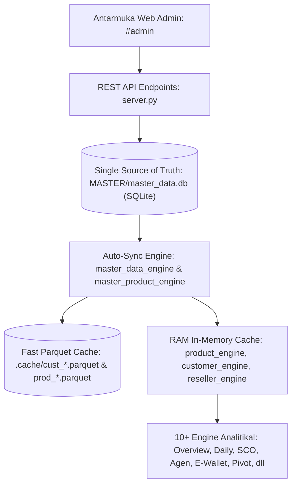

# PANDUAN TEKNIS & DOKUMENTASI RESMI: ADMIN DATA & MASTER HUB

Dokumen ini adalah **Single Source of Truth (SOP Wajib)** untuk modul **Admin Data & Master Hub (`http://localhost:8000/#admin`)** pada sistem **WEB REPORT BI & ANALYTICS**, diperbarui secara komprehensif per **28 Oktober 2026**.

---

## DAFTAR ISI
1. [Filosofi & Arsitektur Web-First](#1-filosofi--arsitektur-web-first)
2. [Standar Desain & Navigasi Halaman (Blueprint #yoy)](#2-standar-desain--navigasi-halaman-blueprint-yoy)
3. [Tab 1: Ingestion, Radar TSV & Data Stream Hub](#3-tab-1-ingestion-radar-tsv--data-stream-hub)
4. [Tab 2: Master Agen & Reseller (Pohon Hierarki MLM & Kontak Pengirim)](#4-tab-2-master-agen--reseller-pohon-hierarki-mlm--kontak-pengirim)
5. [Tab 3: Master Produk & Kategori (Composite Key & Integrasi E-Wallet)](#5-tab-3-master-produk--kategori-composite-key--integrasi-e-wallet)
6. [Tab 4: Pengaturan User (Keamanan & Hak Akses)](#6-tab-4-pengaturan-user-keamanan--hak-akses)
7. [Tab 5: Status Freshness Sistem (Monitoring Integritas Data & Cache)](#7-tab-5-status-freshness-sistem-monitoring-integritas-data--cache)
8. [Tab 6: Eskalasi AI / Help Me Please (Pusat Tiket Otomasi CS)](#8-tab-6-eskalasi-ai--help-me-please-pusat-tiket-otomasi-cs)
9. [Pemisahan Modul Rekap Finansial ke Halaman #pivot-admin](#9-pemisahan-modul-rekap-finansial-ke-halaman-pivot-admin)
10. [Arsitektur Caching Berjenjang (Hierarchical Cache L1-L4)](#10-arsitektur-caching-berjenjang-hierarchical-cache-l1-l4)
11. [Katalog Lengkap REST API Endpoints (`server.py`)](#11-katalog-lengkap-rest-api-endpoints-serverpy)
12. [Panduan Operasional & Troubleshooting](#12-panduan-operasional--troubleshooting)

---

## 1. FILOSOFI & ARSITEKTUR WEB-FIRST

Sebelumnya, manajemen data transaksi dan master customer bergantung pada pengeditan file spreadsheet manual (`CUSTOMER_ASTAGA.xlsx`, `PRODUCT_ASTAGA.xlsx`, dll). Pendekatan tersebut memiliki kelemahan mendasar:
- **Resiko Human Error**: Kolom tergeser, spasi tidak terlihat, atau duplikasi kode.
- **Konflik Antar Brand**: Kode produk yang sama antara ASTAGA dan OKIPAY (misal `DN100`, `T150`) berisiko tertimpa jika tidak diisolasi dengan *composite key*.
- **Ketergantungan Restart**: Setiap kali file diedit manual, server web harus di-restart agar memori cache terbarui.
- **Pemisahan Database OtomaX**: Di server OtomaX, data akun reseller (`reseller`) dan nomor kontak (`pengirim`) tersimpan pada tabel terpisah, membutuhkan rekonsiliasi otomatis saat ditarik ke sistem BI.

### Solusi: Arsitektur Modern Web-First (SQLite + Parquet + RAM)
Modul **Admin Data & Master Hub** memusatkan seluruh manajemen data ke dalam satu panel terpadu:


---

## 2. STANDAR DESAIN & NAVIGASI HALAMAN (BLUEPRINT #YOY)

Halaman `#admin` mengadopsi standar arsitektur desain visual dari **Blueprint `#yoy`** sesuai pedoman non-negotiable pada `GEMINI.md`:
1. **Top Header (`.admin-header`)**:
   - Flex horizontal ramping dengan judul `<h1>Admin &amp; Olah Data</h1>`.
   - Subtitle berbentuk pill badge border-first dengan dot indikator warna (`.period-pill` & `.period-dot`).
2. **Navigasi Tab (`.admin-tabs`)**:
   - Garis batas bawah halus (`border-bottom: 1px solid var(--surface-border)`).
   - Tombol tab flat transparan dengan efek garis bawah aktif `border-bottom: 2px solid var(--primary)`.
   - Menggunakan icon Vector SVG murni (Feather/Lucide style, `stroke-width="2"`, tanpa karakter emoji Unicode).
   - Penomoran terstruktur 6 Tab:
     - `Tab 1: Ingestion & Radar TSV`
     - `Tab 2: Master Agen & Reseller`
     - `Tab 3: Master Produk & Kategori`
     - `Tab 4: Pengaturan User`
     - `Tab 5: Status Freshness Sistem`
     - `Tab 6: Eskalasi AI (Help Me Please)`
3. **UI Dark Mode & High Contrast**:
   - Seluruh kontainer kartu (`.card-box`), dropzone, dan input file menggunakan token variabel CSS `--surface`, `--surface-card`, `--surface-bg`, `--surface-border`, dan `--text-main` untuk menjamin kontras rasio tinggi (>10:1) di tema gelap maupun terang.

---

## 3. TAB 1: INGESTION, RADAR TSV & DATA STREAM HUB

Tab 1 bertugas mengotomasi pipeline penerimaan data transaksi harian dari server OtomaX ke dalam penyimpanan Parquet dan database BI lokal, serta menyediakan jalur data stream ke aplikasi eksternal.

### 3.1. Direct TSV Uploader & Fast Parquet
- **Dropzone Adaptif (`.admin-dropzone`)**: Operator dapat menarik (*drag-and-drop*) atau memilih file TSV mentah transaksi harian OtomaX (`direct-tsv-file-input`).
- **Otomasi Pemrosesan**: Setelah file dipilih, engine otomatis mengeksekusi upsert ke partisi bulanan Parquet (`.cache/parts/astaga_YYYY_MMYY.parquet`) dan Parquet tahunan (`.cache/trx_astaga_YYYY.parquet`).
- **Hasil Pemrosesan Real-time**: Menampilkan total baris mentah, baris bersih, baris baru yang di-append, baris lama yang di-update statusnya, dan durasi engine dalam detik.

### 3.2. Integrasi Data Stream (Live Web Stream untuk Power BI & Excel)
Menyediakan URL endpoint yang dapat disalin (*Copy Link*) atau diunduh langsung untuk ditarik secara otomatis oleh Power BI Desktop / Excel Power Query via konektor *From Web*:
1. **Transaksi Excel Power Query (CSV Stream)**:
   `https://depas.my.id/api/export/transactions.csv?brand=ASTAGA&year=2026&month=2026-10&key=depas2026`
2. **Transaksi Power BI Desktop (Parquet Stream)**:
   `https://depas.my.id/api/export/transactions.parquet?brand=ASTAGA&year=2026&month=2026-10&key=depas2026`
3. **Master Toko & Reseller Downline (Customer Stream)**:
   `https://depas.my.id/api/export/customers.csv?brand=ASTAGA&key=depas2026`
4. **Master Toko Induk / Agen dengan GPS (Agent Stream)**:
   `https://depas.my.id/api/export/agents.csv?brand=ASTAGA&key=depas2026`
5. **Master SKU & Kategori Produk (Product Stream)**:
   `https://depas.my.id/api/export/products.csv?brand=ASTAGA&key=depas2026`
6. **Rekap Finansial Bulanan (Excel Stream)**:
   `https://depas.my.id/api/export/finance-rekap.xlsx?brand=ASTAGA&year=2026&month=2026-10&key=depas2026`

### 3.3. Radar Audit Master (Deteksi Unmapped Reseller & Produk)
- Memindai otomatis setiap baris transaksi yang baru masuk:
  - **Unmapped Reseller**: Reseller yang aktif bertransaksi namun kodenya belum terdaftar di tabel `resellers`.
  - **Unmapped Produk**: SKU produk yang memiliki transaksi namun belum terdaftar di katalog `products`.
- Menyediakan tombol 1-klik `+ Tambah` yang langsung membuka form modal untuk mendaftarkan kode tersebut ke Master tanpa perlu mengetik ulang.

---

## 4. TAB 2: MASTER AGEN & RESELLER (POHON HIERARKI MLM & KONTAK PENGIRIM)

Tab 2 mengelola seluruh struktur keagenan, hierarki MLM downline, pemetaan cabang, tim sales lapangan (SCO/DSO), dan basis data nomor kontak pengirim.

### 4.1. Twin Upload Cards (Dua Uploader Berdampingan)
Di bagian atas tab terdapat dua kartu unggah berdampingan yang menyelesaikan tantangan terpisahnya database OtomaX:
1. **Kartu Kiri (Aksen Cyan - Akun & Pohon MLM)**:
   - Digunakan untuk mengunggah file Master Reseller dari OtomaX (`astaga.tsv` / `okipay.tsv`).
   - Memetakan relasi `Kode` $\rightarrow$ `Kode Upline` secara rekursif hingga menemukan Toko Induk (`root_agen_id`) dan cabang resmi.
   - Menyimpan saldo, limit saldo, markup, tanggal daftar, dan tanggal aktivitas terakhir ke tabel SQLite `agents` dan `resellers`.
2. **Kartu Kanan (Aksen Emerald - Nomor Pengirim SMS & WA)**:
   - Digunakan untuk mengunggah file Master Pengirim dari OtomaX (`KONTAK_ASTAGA.tsv` / `KONTAK_OKIPAY.tsv`).
   - Menyaring nomor HP jalur SMS (`S`), WhatsApp (`W`), dan Jabber (`G`, `J`, `IP`).
   - Membersihkan nomor ke format standar `628xxxxxxxxxx`.
   - Mengelompokkan seluruh nomor unik reseller ke kolom `candidate_phones` (JSON array) pada tabel `reseller_contacts`.

### 4.2. Logika Sinergi Self-Transaksi E-Wallet (Gestun Detection)
Nomor pengirim yang diimpor pada Kartu Kanan terhubung langsung dengan engine analisa fraud di halaman **`#ewallet`** (`engines/fraud_engine.py`):
$$\text{Self-Transaksi (Gestun)} \iff \text{clean\_tujuan (Trx)} \in \text{candidate\_phones (Reseller)}$$
Jika reseller mengisi saldo e-wallet (DANA, OVO, GOPAY, ShopeePay, dll) ke nomor HP yang identik dengan nomor pengirim yang didaftarkannya di sistem, transaksi tersebut otomatis diklasifikasikan sebagai **Self-Transaksi**.

### 4.3. Unified KPI Summary Bar (`.master-unified-kpi-bar`)
Menampilkan ringkasan metrik dalam satu bar horizontal ramping border-first:
- **Total Agen (Induk)**: Jumlah entitas toko induk terdaftar (`#kpi-total-agents`).
- **Tim Sales (SCO)**: Toko binaan yang memiliki PIC sales lapangan (`#kpi-sales-sco`).
- **Cabang (NON SCO)**: Omset langsung cabang fisik tanpa tim sales lapangan (`#kpi-non-sco`).
- **Cabang ONLINE**: Pendaftaran mandiri PlayStore / non-fisik (`#kpi-online-sco`).
- **Belum Dipetakan**: Status agen yang belum memiliki pemetaan cabang/SCO (`#kpi-unmapped-sco`).
- **Total Reseller (MLM)**: Seluruh jaringan downline dan toko induk (`#kpi-total-resellers`).

### 4.4. Hukum Bisnis Tipe Agen & Tim Sales (GEMINI.md Rules 7 & 8)
- **3 Klasifikasi Tipe Agen Resmi ASTAGA**:
  1. `Limit`: Agen dengan fasilitas plafon kredit/limit saldo aktif (`limit_saldo != 0`).
  2. `Non Limit`: Agen cabang fisik non-prima yang limit saldonya di-nolkan (`limit_saldo == 0`).
  3. `Prima`: Reseller grup P reguler dan seluruh pendaftaran mandiri cabang `ONLINE`.
- **Aturan Tim Sales (SCO)**:
  - Cabang `ONLINE` **WAJIB** memiliki `SCO = 'ONLINE'`.
  - Cabang Fisik (`BSD`, `ICON`, `PP`, `PRG`) berstatus nama petugas sales masing-masing atau `NON SCO` (untuk agen walk-in fisik). Cabang fisik dilarang berstatus `ONLINE`.

### 4.5. Fitur CRUD & Modal Live Edit:
- **Pohon Hierarki Downline (`Modal Downline`)**: Menampilkan seluruh anak ranting reseller di bawah toko induk, lengkap dengan kedalaman level, upline langsung, dan saldo.
- **Form Edit Agen**: Memungkinkan pengubahan nama agen, cabang induk (otomatis mempropagasi seluruh downline di bawahnya), tipe agen, nama SCO, DSO, jadwal kunjungan, dan koordinat GPS.
- **Tambah Agen Baru**: Mendaftarkan akun agen induk baru langsung dari browser.
- **Unduh Excel**: Mengekspor master agen dan reseller lengkap ke format `.xlsx`.

---

## 5. TAB 3: MASTER PRODUK & KATEGORI (COMPOSITE KEY & INTEGRASI E-WALLET)

Tab 3 mengelola katalog seluruh SKU produk voucher pulsa, paket data, token PLN, e-wallet, dan tagihan PPOB.

### 5.1. Masalah Kode Produk Ganda & Solusi Composite Key
ASTAGA dan OKIPAY memiliki 395 kode produk yang sama persis (contoh: `DN100`, `T150`, `S10`). Untuk mencegah saling timpa, tabel `products` menggunakan **Composite Primary Key**:
```sql
CREATE TABLE products (
    brand        TEXT NOT NULL,
    kode_produk  TEXT NOT NULL,
    nama_produk  TEXT NOT NULL,
    kategori     TEXT NOT NULL,
    operator     TEXT NOT NULL,
    paket        TEXT,
    is_active    INTEGER DEFAULT 1,
    updated_at   TEXT,
    PRIMARY KEY (brand, kode_produk)
);
```

### 5.2. Unified KPI Summary Bar Produk (`.product-unified-kpi-bar`)
- **Total Produk**: Item SKU terdaftar di sistem (`#kpi-total-products`).
- **Total Kategori**: TELCO, EWALLET, PLN, PPOB, dll (`#kpi-total-categories`).
- **Total Operator**: Provider telekomunikasi & merchant e-wallet (`#kpi-total-operators`).
- **Unmapped / Belum Kategori**: SKU berkategori LAINNYA yang butuh klasifikasi (`#kpi-unmapped-categories`).

### 5.3. Fitur Utama Web Admin Produk:
- **Pencarian Cepat & Filter Multi-Kategori**: Filter Brand, Kategori, Operator, dan Paket.
- **Modal Tambah & Edit Produk**: Autocomplete datalist kategori dan operator dari database existing.
- **Ekspor Excel**: Mengunduh katalog master produk resmi ke format Microsoft Excel.

---

## 6. TAB 4: PENGATURAN USER (KEAMANAN & HAK AKSES)

Tab 4 mengelola akses login dan kredensial pengguna aplikasi Web Report.

### 6.1. Penyimpanan & Enkripsi Kredensial
- Kredensial tersimpan secara terisolasi di `MASTER/auth_users.json`.
- Password dienkripsi menggunakan hashing kriptografi aman **SHA-256 dengan Salt Dinamis**:
  $$\text{hash} = \text{SHA256}(\text{salt} + \text{password\_plain})$$
- Password plain text tidak pernah disimpan di database atau memori log.

### 6.2. Role & Tingkat Kewenangan:
1. `admin`: Akses penuh terhadap seluruh modul pelaporan, ingestion data, manajemen master agen/produk, pengaturan user, dan ekspor data.
2. `management`: Akses penuh terhadap seluruh dashboard analitika eksekutif, rekap finansial, laporan harian, dan ringkasan SCO (read-only pada tabel master).
3. `viewer`: Akses terbatas untuk monitoring laporan operasional tanpa akses ke pengaturan dapur/admin.

### 6.3. Fitur Manajemen User:
- Penambahan akun pengguna baru (*Create User*).
- Pengubahan password pengguna yang aman (*Reset / Change Password*).
- Pengaktifan/penonaktifan akses user tanpa menghapus histori akun.

---

## 7. TAB 5: STATUS FRESHNESS SISTEM (MONITORING INTEGRITAS DATA & CACHE)

Tab 5 adalah pusat telemetri dan diagnostik kesehatan data server lokal.

### 7.1. Komponen Monitoring:
- **Status Parquet Transaksi**: Memeriksa keberadaan dan ukuran file partisi bulanan (`.cache/parts/`) serta cache master tahunan.
- **Timestamp Terakhir (Freshness Watermark)**: Menampilkan tanggal dan jam transaksi terakhir yang berhasil masuk ke sistem.
- **Integritas Database SQLite**: Memeriksa jumlah baris tabel `agents`, `resellers`, `reseller_contacts`, dan `products`.
- **Status Sinkronisasi VPS Cloud**: Memantau konektivitas sinkronisasi data stream antara server lokal dan domain public `https://depas.my.id`.

### 7.2. Tombol Aksi Sistem:
- **Bersihkan & Rebuild Cache (Clear RAM & Parquet Cache)**: Membersihkan memory leak, memaksa engine analitikal memuat ulang data dari SQLite dan Parquet terbaru.
- **Trigger Sync VPS**: Memicu sinkronisasi manual file partisi ke server cloud.

---

## 8. TAB 6: ESKALASI AI / HELP ME PLEASE (PUSAT TIKET OTOMASI CS)

Tab 6 adalah antarmuka pemantauan tiket kendala yang diajukan oleh agen atau tim operasional melalui bot Telegram terintegrasi (**`@depas_ai_bot`** / `tele_bot.py`).

### 8.1. Alur Penanganan Tiket:
1. **Penerimaan Tiket**: Saat agen melaporkan kendala saldo, transaksi pending, atau verifikasi akun ke bot Telegram, sistem otomatis membuat ID tiket unik (misal: `TKT-20261028-XXXXXX`).
2. **Klasifikasi AI**: Copilot AI secara cerdas menganalisis sentimen, kategori kendala, serta mengecek status transaksi terkait di database.
3. **Antrean di Web Admin**: Tiket muncul di tabel antrean Tab 6 lengkap dengan nama toko/agen, nomor WA/Telegram, ringkasan masalah, tingkat urgensi (*Urgent, Normal, Low*), dan status (*Open, In Progress, Resolved*).
4. **Penyelesaian**: Tim admin dapat mengubah status tiket dan mengirimkan balasan langsung ke Telegram agen dari sistem.

---

## 9. PEMISAHAN MODUL REKAP FINANSIAL KE HALAMAN #PIVOT-ADMIN

Sesuai pembaruan arsitektur antarmuka:
- Modul rekapitulasi finansial bulanan (Omset, Modal, Gross Margin, Komisi Markup Upline, dan Net Profit Server) yang sebelumnya berada di tab internal admin, kini telah **DIPISAHKAN SECARA RESMI MENJADI HALAMAN MANDIRI**.
- Halaman tersebut dapat diakses melalui menu sidebar di bawah menu Admin dengan rute:
  👉 **`http://localhost:8000/#pivot-admin`** (`pages/pivot_admin/index.html`)
- Halaman ini menggunakan *financial pivot engine* terdedikasi (`engines/profit_engine.py`) dengan dukungan ekspor Excel resmi, filter multi-tahun, dan perhitungan net yield per transaksi.

---

## 10. ARSITEKTUR CACHING BERJENJANG (HIERARCHICAL CACHE L1-L4)

Untuk menjamin kecepatan dashboard tetap berada di bawah **50 milidetik**, sistem menerapkan strategi caching 4 lapis:

| Lapis | Media Simpan | Komponen | Waktu Akses | Mekanisme Refresh |
|:---:|---|---|:---:|---|
| **Level 1** | In-Memory RAM | `_PROD_MAP`, `_CABANG_MAP`, `_MEMORY_CACHE` | $< 0.001\text{ s}$ | Invalidate otomatis via `clear_cache()` saat ada update master/transaksi. |
| **Level 2** | Fast Parquet | `.cache/cust_*.parquet`, `.cache/prod_*.parquet`, partisi trx | $< 0.005\text{ s}$ | Auto-generate oleh engine master data saat TSV di-upsert. |
| **Level 3** | Relational DB | `MASTER/master_data.db` (SQLite) | $< 0.020\text{ s}$ | Single Source of Truth; ACID compliant, terindeks `(brand, kode)`. |
| **Level 4** | Dokumen Ekspor | File Excel `.xlsx` dan CSV di `C:\DMS RAW DATA\MASTER\` | On-Demand | Dibuat saat tombol export ditekan atau auto-backup sinkronisasi. |

---

## 11. KATALOG LENGKAP REST API ENDPOINTS (`server.py`)

Seluruh komunikasi frontend Web Admin dengan backend menggunakan Starlette REST API:

### A. Ingestion & Upload File
* **`POST /api/admin/upload-tsv`**: Mengunggah dan upsert transaksi harian langsung ke Parquet bulanan/tahunan.
* **`POST /api/admin/upload-reseller-tsv`**: Mengunggah master reseller OtomaX (`astaga.tsv` / `okipay.tsv`), rekursi pohon MLM, dan update tabel `agents` & `resellers`.
* **`POST /api/admin/upload-pengirim-tsv`**: Mengunggah master nomor pengirim OtomaX (`KONTAK_ASTAGA.tsv` / `KONTAK_OKIPAY.tsv`) dan update tabel `reseller_contacts`.
* **`GET /api/admin/status`**: Memeriksa status watermark transaksi dan ketersediaan file TSV baru.
* **`POST /api/admin/upsert`**: Memicu background upsert job dari folder RAW DATA.
* **`GET /api/admin/job-status`**: Memeriksa progres realtime job upsert yang sedang berjalan.

### B. Master Reseller & Agen
* **`GET /api/admin/agents`**: Query daftar agen induk dengan filter brand, cabang, SCO, tipe, pencarian nama/ID, dan paginasi.
* **`GET /api/admin/agents/detail`**: Mengambil detail profil toko induk beserta daftar seluruh pohon downline di bawahnya.
* **`POST /api/admin/agents/save`**: Menyimpan perubahan metadata profil agen (SCO, DSO, cabang, jadwal, lokasi GPS, tipe).
* **`GET /api/admin/agents/export`**: Mengunduh master agen dan reseller dalam format Microsoft Excel.

### C. Master Produk SKU
* **`GET /api/admin/products`**: Query katalog SKU dengan filter kategori, operator, paket, pencarian, dan paginasi.
* **`GET /api/admin/products/detail`**: Mengambil detail atribut produk tertentu.
* **`POST /api/admin/products/save`**: Menyimpan atau mendaftarkan SKU produk baru ke database dan cache Parquet.
* **`GET /api/admin/products/export`**: Mengunduh katalog master produk dalam format Microsoft Excel.

### D. Live Data Stream (Power BI & Excel)
* **`GET /api/export/transactions.csv`**: Stream transaksi format CSV dengan parameter `brand`, `year`, `month`, dan `key`.
* **`GET /api/export/transactions.parquet`**: Stream transaksi mentah format Parquet biner teroptimasi.
* **`GET /api/export/customers.csv`**: Stream data toko reseller dan agen.
* **`GET /api/export/agents.csv`**: Stream data toko induk dan koordinat wilayah.
* **`GET /api/export/products.csv`**: Stream katalog SKU produk.
* **`GET /api/export/finance-rekap.xlsx`**: Stream rekapitulasi finansial Excel.

### E. User & Tiket Eskalasi
* **`GET /api/admin/users`**: Mengambil daftar user terdaftar.
* **`POST /api/admin/users/save`**: Menambah user baru atau mengubah password/role.
* **`POST /api/admin/users/delete`**: Menghapus akun user.
* **`GET /api/admin/tickets`**: Mengambil daftar tiket antrean kendala agen dari bot AI.
* **`POST /api/admin/tickets/update`**: Memperbarui status tiket (*In Progress, Resolved*).

---

## 12. PANDUAN OPERASIONAL & TROUBLESHOOTING

### 12.1. Alur Rutin Sinkronisasi Master Data Bulanan
1. Unduh file Master Reseller terbaru dari OtomaX (`astaga.tsv` atau `okipay.tsv`).
2. Buka **`#admin?tab=master`**, arahkan ke kartu sebelah kiri (**Upload & Sinkronisasi Data Reseller**).
3. Pilih file TSV reseller. Dalam 1–2 detik, hierarki pohon MLM akan terpetakan ulang dan status toko ter-refresh.
4. Unduh file Master Pengirim terbaru dari OtomaX (`KONTAK_ASTAGA.tsv` atau `KONTAK_OKIPAY.tsv`).
5. Pada tab yang sama, arahkan ke kartu sebelah kanan (**Upload & Sinkronisasi Nomor Pengirim**).
6. Pilih file kontak pengirim. Dalam < 1 detik, seluruh nomor WA dan SMS reseller akan terbarui di database SQLite, dan modul deteksi self-transaksi di `#ewallet` otomatis siap digunakan.

### 12.2. Mengatasi Reseller atau Produk yang Muncul di Peringatan Unmapped
1. Buka **`#admin?tab=ingestion`**.
2. Gulir ke bawah pada bagian **Audit Master: Kode Baru Terdeteksi di Transaksi**.
3. Jika ada item yang muncul, klik tombol **`+ Tambah`** di samping kode tersebut.
4. Form modal pendaftaran akan terbuka otomatis dengan ID yang sudah terisi.
5. Lengkapi data (misal pilih Cabang untuk Agen, atau Kategori untuk Produk) lalu klik **Simpan**. Peringatan unmapped seketika hilang.

### 12.3. Mengatasi Cache Macet atau Angka Tidak Berubah
1. Buka **`#admin?tab=status`**.
2. Klik tombol **Bersihkan & Rebuild Cache (Clear Cache)**.
3. Sistem akan menghapus in-memory cache RAM dan membaca ulang file Parquet terbaru.

---
*Dokumen ini adalah spesifikasi arsitektur resmi WEB REPORT yang dijaga integritasnya untuk seluruh pengembangan modul Administrasi & Master Hub.*
